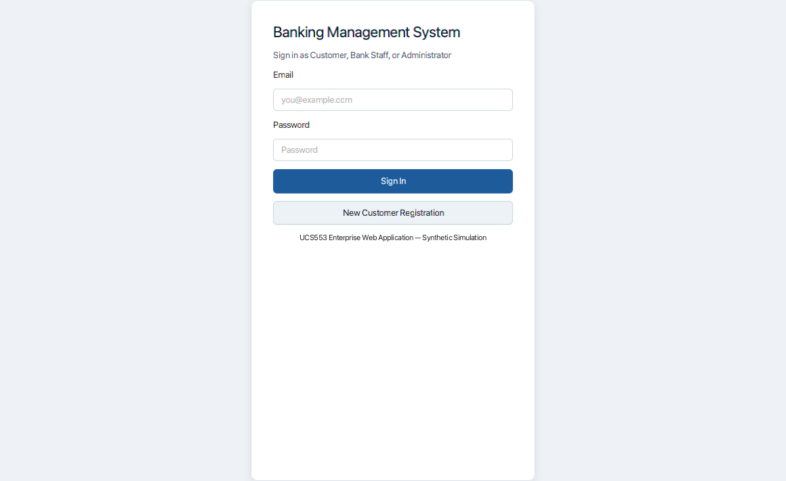
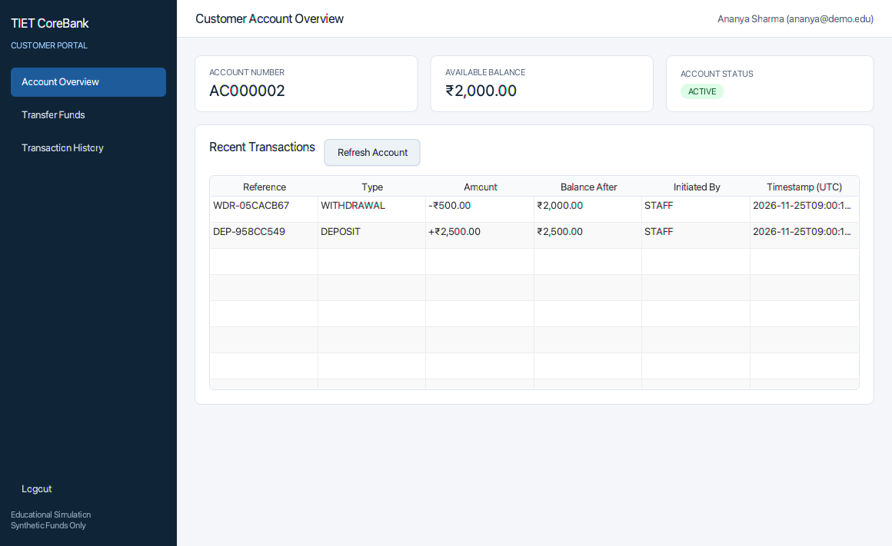
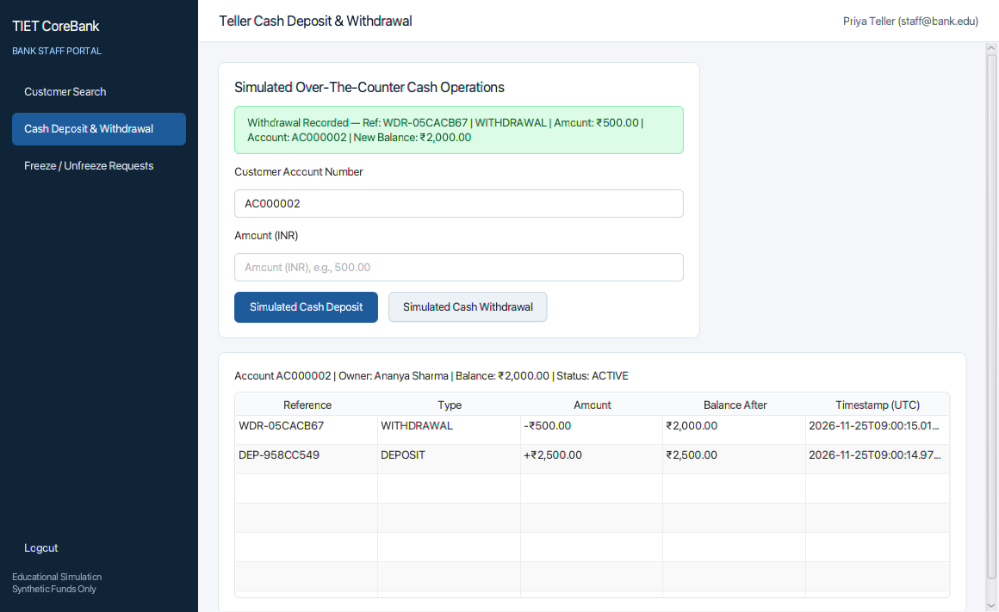
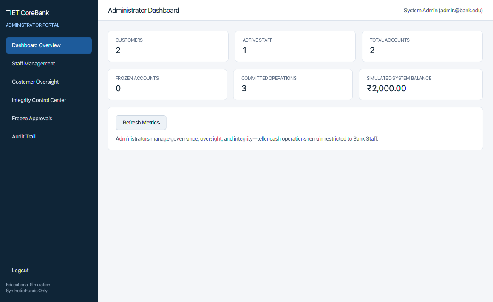
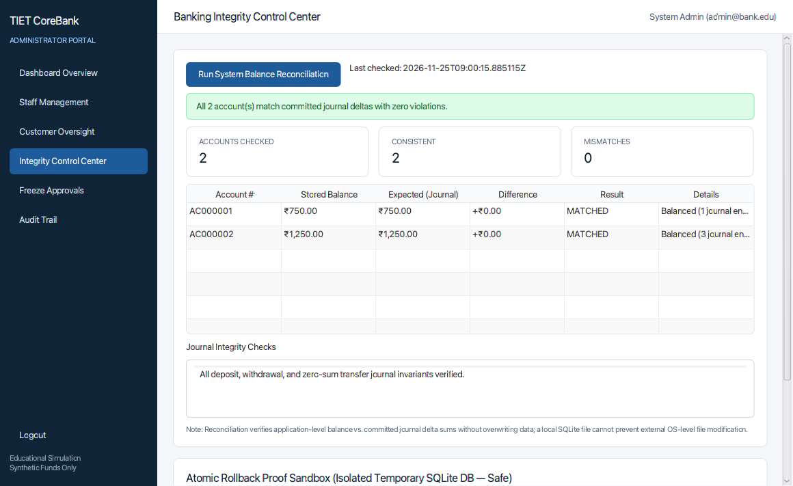

# Banking Management System (UCS553 — Enterprise Web Application)

An educational Core Java 17 desktop banking simulation developed for **UCS553 — Enterprise Web Application** at **Thapar Institute of Engineering and Technology (TIET), Patiala**, built with **JavaFX 17**, **Plain JDBC**, **SQLite**, and **Maven**.

---

## Main Features

- **First-Run Administrator Setup:** Prompts for an operator-chosen password on first launch (salted `PBKDF2WithHmacSHA256`), permanently locks initial setup once an administrator exists, and includes zero hardcoded default credentials.
- **Customer Registration & Authentication:** Public registration atomically creates a `CUSTOMER` login and one active zero-balance account (`AC000001` format); unified sign-in routes `Customer`, `Bank Staff`, and `Administrator` sessions.
- **Role-Based Dashboards:** Dedicated JavaFX workspaces for Customers, Bank Staff, and Administrators styled with `banking.css`.
- **Simulated Teller Operations:** Staff can search customers/accounts and execute simulated cash deposits and withdrawals with immediate transaction receipts.
- **Internal Fund Transfers:** Customers can transfer simulated funds to another active customer account with atomic debit/credit updates and zero-sum journal entries.
- **Transaction History & CSV Statement Export:** Customers and Staff can view chronological transaction tables; Customers can export RFC-4180 CSV statements with spreadsheet formula-injection neutralization.
- **Role-Based Authorization:** Service-layer RBAC and customer account ownership checks enforce non-teller administrator boundaries (`STAFF` executes cash operations; `ADMIN` has governance and read-only customer oversight).
- **Persistent SQLite Storage:** 7-table schema (`PRAGMA foreign_keys = ON`, WAL mode) accessed exclusively via Plain JDBC `PreparedStatement` DAOs and explicit `TransactionExecutor` / `BankingUnitOfWork` atomicity.
- **Banking Integrity Control Center:**
  - **Balance Reconciliation:** Non-destructive check comparing stored `balance_paise` against committed journal sums (`SUM(delta_paise)`) and transfer zero-sum invariants.
  - **Atomic Rollback Proof Sandbox:** Demonstrates mid-transfer failure rollback on an isolated temporary SQLite database without touching live data.
  - **Maker-Checker Account Control:** Staff request account freeze/unfreeze actions reviewed by an Administrator; frozen accounts remain viewable while rejecting debits, credits, and transfers.
  - **Administrative Audit Trail:** Same-transaction audit logging of sensitive governance actions, searchable in the Admin dashboard.
- **Persistent Duplicate-Request Protection:** `idempotency_records` supports safe duplicate-request replay and payload-conflict detection across financial operations.

> Optional `P2` extensions (explainable fraud alerts, transaction disputes, and multiple account types) remain deferred outside this release baseline.

---

## Application Screenshots

All screenshots below are genuine captures from the live JavaFX application using synthetic demo data.

### Login Screen


### Customer Dashboard


### Bank Staff Dashboard


### Administrator Dashboard


### Banking Integrity Control Center


See [docs/report/TECHNICAL_REPORT_EVIDENCE.md](docs/report/TECHNICAL_REPORT_EVIDENCE.md) for all 12 captured screenshots and architecture diagrams.

---

## Prerequisites

- **JDK 17** (any standard Java 17 distribution on `PATH`)
- **Maven Wrapper included** (`./mvnw` / `.\mvnw.cmd`) — pre-installed Maven is optional (or Apache Maven 3.9+ if running `mvn` directly)
- **Graphical desktop session** (required to launch the JavaFX UI and execute the live GUI test)
- **Internet access on first build** (to download Maven Wrapper distribution and Maven/JavaFX/SQLite dependencies into the local `~/.m2` cache)

---

## Installation & Launch

### 1. Clone and enter the repository

```bash
git clone https://github.com/Prachi-Mehta-376/Banking_Management_System_JAVA.git
cd Banking_Management_System_JAVA
```

### 2. Verify Java 17

```bash
java -version
```

Confirm the output reports Java `17.x`. If you have multiple JDKs installed and `java -version` prints a different version, set `JAVA_HOME` in your terminal before running Maven commands:

- **macOS / Linux:** `export JAVA_HOME=/path/to/jdk-17`
- **Windows (PowerShell):** `$env:JAVA_HOME = "C:\Path\To\jdk-17"`

### 3. Build and run tests

- **macOS / Linux:**
  ```bash
  ./mvnw clean test
  ```
- **Windows (PowerShell):**
  ```powershell
  .\mvnw.cmd clean test
  ```

### 4. Launch the JavaFX application

- **macOS / Linux:**
  ```bash
  ./mvnw javafx:run
  ```
- **Windows (PowerShell):**
  ```powershell
  .\mvnw.cmd javafx:run
  ```

> **Platform verification note:** Verified on macOS (`arm64`, Temurin JDK 17). Windows and Linux execution rely on the standard Maven Wrapper, OpenJFX platform classifiers, and `sqlite-jdbc` native libraries, and have not been directly tested on those operating systems.

---

## First-Run Walkthrough

On launch, the application automatically initializes its local SQLite database at `data/banking.db`. No default credentials are bundled.

1. **Initial Administrator Setup:** On first launch, create your Administrator account with a custom password (minimum 8 characters).
2. **Administrator Dashboard:** After setup completes, the application signs you into the Administrator workspace.
3. **Create a Staff Account:** Open **Staff Management** and provision a Bank Staff account.
4. **Register Two Customer Accounts:** Log out, click **New Customer Registration**, and register two synthetic customers (assigned `AC000001` and `AC000002` at `₹0.00`).
5. **Deposit Simulated Cash:** Log in as the Bank Staff user, open **Cash Deposit & Withdrawal**, and deposit simulated funds into `AC000001`.
6. **Transfer Funds:** Log in as the first Customer, open **Transfer Funds**, and transfer an amount to `AC000002`.
7. **Inspect History & Export CSV:** Open **Transaction History** to verify newest-first entries and test **Export CSV Statement**.
8. **Explore the Integrity Control Center:** Log back in as Administrator to run **System Balance Reconciliation**, execute the isolated **Atomic Rollback Proof Sandbox**, test **Freeze Approvals**, and inspect the **Audit Trail**.

---

## Project Structure

```text
Banking_Management_System_JAVA/
├── pom.xml                           # Java 17, JavaFX 17.0.12, sqlite-jdbc 3.46.1.0, JUnit 5
├── mvnw / mvnw.cmd                   # Official Apache Maven Wrapper scripts
├── .mvn/wrapper/                     # Maven Wrapper configuration
├── src/
│   ├── main/java/com/tiet/banking/
│   │   ├── bootstrap/                # BankingApp, Launcher, ServiceRegistry
│   │   ├── model/                    # Money (long paise), domain enums & records
│   │   ├── dto/                      # Presentation/service boundary records
│   │   ├── exception/                # Typed domain, auth, freeze & commit exceptions
│   │   ├── db/                       # DatabaseManager, TransactionExecutor, BankingUnitOfWork
│   │   ├── dao/ & dao/jdbc/          # DAO interfaces and Plain JDBC implementations
│   │   ├── security/                 # Salted PBKDF2 PasswordHasher & SessionManager
│   │   ├── service/                  # Auth, Customer, Teller, Staff, Admin, Reconciliation, Control
│   │   ├── util/                     # AppConfig, AppLogger, InputValidator, CsvStatementExporter
│   │   └── ui/                       # JavaFX auth views & Customer/Staff/Admin dashboards
│   ├── main/resources/               # db/schema.sql & styles/banking.css
│   └── test/java/com/tiet/banking/   # Unit, DAO, integration & live JavaFX GUI tests
├── context/                          # Persistent engineering context, ADRs & session logs
└── docs/                             # Architecture contracts, requirements, tests & report evidence
```

---

## Testing

Run the full suite (12 JUnit 5 tests across 5 test classes: `MoneyValidationTest`, `DatabasePersistenceTest`, `AuthAndRbacTest`, `BankingEngineIntegrationTest`, and `LiveGuiVerificationAndScreenshotTest`):

```bash
./mvnw clean test          # macOS / Linux
.\mvnw.cmd clean test      # Windows (PowerShell)
```

Latest verified result: **12 tests run, 0 failures, 0 errors, 0 skipped**.

- `LiveGuiVerificationAndScreenshotTest` drives the live JavaFX `Scene` and requires an active desktop display; it writes test screenshots to JUnit's temporary directory by default so running tests never modifies tracked repository files under `docs/report/screenshots/`.
- To run only the non-GUI tests in a headless terminal or CI environment:

```bash
./mvnw test -DexcludedGroups=gui          # macOS / Linux (11 tests)
.\mvnw.cmd test -DexcludedGroups=gui      # Windows (PowerShell, 11 tests)
```

---

## Limitations

- **Academic Simulation:** Built solely for UCS553 coursework evaluation using simulated funds and synthetic customer records.
- **Not Production Banking Software:** Lacks external payment rails, real KYC/identity verification, multi-branch concurrency infrastructure, and hardened deployment controls.
- **Local SQLite Security Boundary:** Data is stored in a local `data/banking.db` file; anyone with OS-level filesystem access to that file can inspect or modify it outside the application.
- **No Regulatory Claims:** Makes no claim of RBI approval, PCI-DSS certification, or statutory banking compliance.

---

## Additional Documentation

- [Technical Report Evidence & Diagrams](docs/report/TECHNICAL_REPORT_EVIDENCE.md)
- [System Architecture](docs/architecture/SYSTEM_ARCHITECTURE.md) & [Database Design](docs/architecture/DATABASE_DESIGN.md)
- [Service Contracts](docs/architecture/SERVICE_CONTRACTS.md) & [Role Permissions](docs/architecture/ROLE_PERMISSIONS.md)
- [Test Plan](docs/testing/TEST_PLAN.md) & [Current Status](context/CURRENT_STATUS.md)
