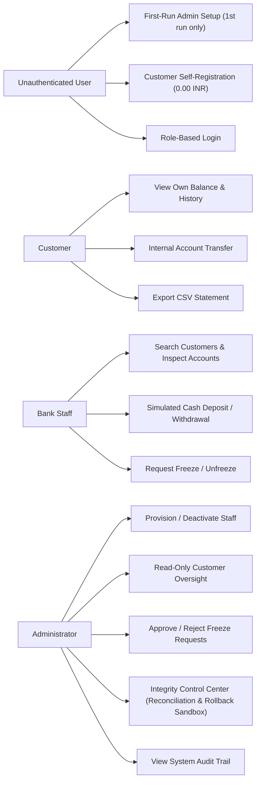
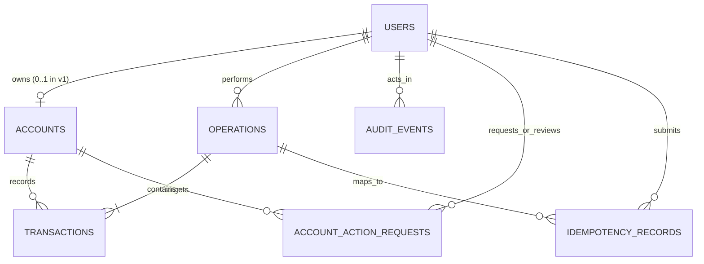
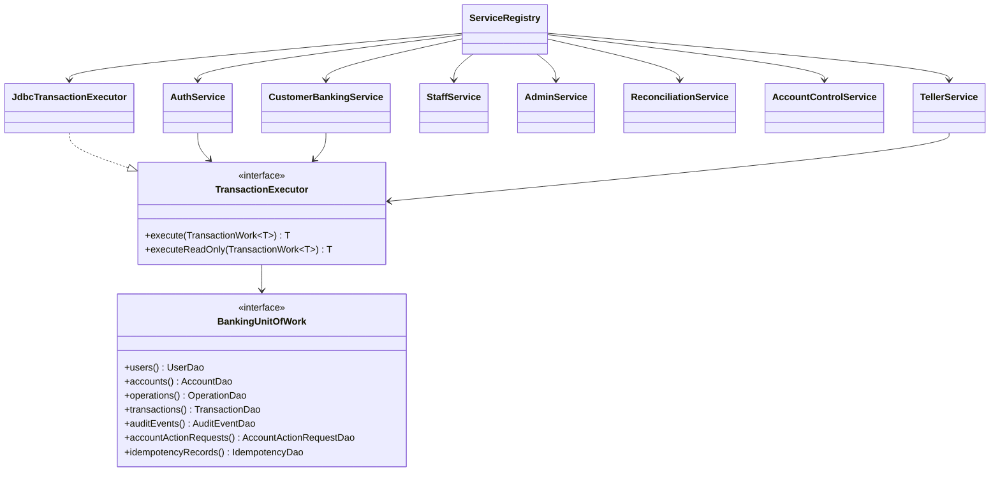
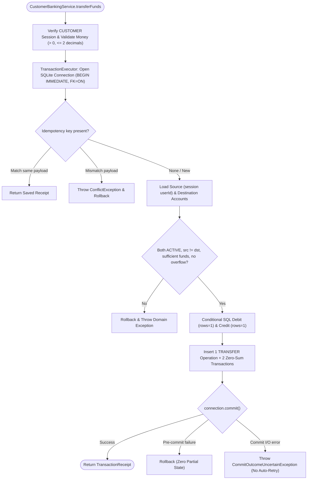

# Technical Report Evidence — Banking Management System (UCS553)

> **Course:** UCS553 — Enterprise Web Application (Thapar Institute of Engineering and Technology)
> **Project Type:** Core Java 17 Desktop Application with JavaFX, Plain JDBC, SQLite & Maven
> **Simulation Notice:** Educational simulation using fictitious customer identities and simulated INR/paise funds. Not a licensed or production-ready banking system.

---

## 1. Missing Personal / Institution Template Inputs (Do Not Invent)

No professor-provided Word/LaTeX cover template was present in `docs/report/`. Before final PDF submission, fill in:
1. Student names and roll numbers corresponding to contributors **S**, **P**, and **R**.
2. Faculty guide / course instructor name and evaluation date.
3. Institute cover-page formatting if required by UCS553 guidelines.

---

## 2. Final System Architecture & Actual Package Structure

The implemented application strictly enforces unidirectional layering:

```text
JavaFX Presentation (com.tiet.banking.ui.*)
  -> Business Services & Security (com.tiet.banking.service.*, security.*)
    -> DAO Interfaces & Transaction Coordinator (com.tiet.banking.dao.*, db.*)
      -> Plain JDBC Implementations (com.tiet.banking.dao.jdbc.*)
        -> SQLite Database (data/banking.db at runtime)
```

### Actual Implemented Package Inventory
- `com.tiet.banking.bootstrap` (`BankingApp`, `Launcher`, `ServiceRegistry`)
- `com.tiet.banking.model` (`Role`, `AccountStatus`, `OperationType`, `AccountActionType`, `RequestStatus`, `Money`, `User`, `BankAccount`, `BankOperation`, `BankTransaction`, `AuditEvent`, `AccountActionRequest`, `IdempotencyRecord`)
- `com.tiet.banking.dto` (`UserSession`, `AccountSummary`, `TransactionReceipt`, `TransactionView`, `CustomerSearchResult`, `StaffUserSummary`, `AdministrativeSummary`, `ReconciliationResult`, `ReconciliationReport`, `AuditEventView`, `AccountActionRequestView`)
- `com.tiet.banking.exception` (`BankingException`, `ValidationException`, `AuthenticationException`, `AuthorizationException`, `ResourceNotFoundException`, `InsufficientFundsException`, `AccountFrozenException`, `ConflictException`, `PersistenceException`, `CommitOutcomeUncertainException`)
- `com.tiet.banking.db` (`DatabaseManager`, `TransactionExecutor`, `TransactionWork`, `BankingUnitOfWork`, `JdbcTransactionExecutor`)
- `com.tiet.banking.dao` & `dao.jdbc` (`UserDao`, `AccountDao`, `OperationDao`, `TransactionDao`, `AuditEventDao`, `AccountActionRequestDao`, `IdempotencyDao` and their `Jdbc*` implementations)
- `com.tiet.banking.security` (`PasswordHasher`, `SessionManager`)
- `com.tiet.banking.service` (`AuthService`, `CustomerBankingService`, `TellerService`, `StaffService`, `AdminService`, `ReconciliationService`, `AccountControlService`)
- `com.tiet.banking.util` (`AppConfig`, `AppLogger`, `InputValidator`, `CsvStatementExporter`)
- `com.tiet.banking.ui` (`common/`, `auth/`, `customer/`, `staff/`, `admin/`)
- `src/main/resources` (`db/schema.sql`, `styles/banking.css`)

---

## 3. Architecture & Design Diagrams (Code-Verified)

### 3.1 Use Case Diagram


### 3.2 Entity-Relationship Diagram (Actual `schema.sql` — 7 Tables)


### 3.3 Core Service & Persistence Class Relationships


### 3.4 Atomic Transfer Activity Diagram


---

## 4. UCS553 Java Concepts Demonstrated (Code-Verified)

| Syllabus Concept | Concrete Application Evidence |
| :--- | :--- |
| **OOP & Value Objects** | Immutable `Money` (`long` paise), Java 17 `record` models/DTOs, enums (`Role`, `AccountStatus`, `OperationType`) |
| **Collections & Generics** | Typed `List<TransactionView>`, `Optional<User>`, generic `TransactionWork<T>` functional callback |
| **Custom Exceptions** | `BankingException` hierarchy (`ValidationException`, `InsufficientFundsException`, `AccountFrozenException`, `CommitOutcomeUncertainException`, etc.) |
| **Plain JDBC & SQLite** | Parameterized `PreparedStatement`, `Statement.RETURN_GENERATED_KEYS`, `PRAGMA foreign_keys = ON`, `BEGIN IMMEDIATE`, `commit`/`rollback` |
| **JavaFX Desktop UI** | Multi-role `AppShell`, CSS-styled cards/badges, `TableView` displays, `Task` async background execution |
| **Java I/O** | `CsvStatementExporter` (`BufferedWriter`, UTF-8, RFC-4180 quoting, spreadsheet formula neutralization) & `/db/schema.sql` stream loading |
| **`java.util.logging`** | `AppLogger` configuring `FileHandler` (`logs/banking.log`) and console logging without plaintext secrets |

---

## 5. Representative Implemented Snippets

### Monetary Precision (`Money.java`)
```java
BigDecimal stripped = amount.stripTrailingZeros();
if (stripped.scale() > 2) {
    throw new ValidationException("Amount cannot have more than two decimal places.");
}
long paise = amount.movePointRight(2).longValueExact();
```

### Conditional SQL Debit (`JdbcAccountDao.java`)
```java
String sql = """
        UPDATE accounts
        SET balance_paise = balance_paise - ?
        WHERE id = ? AND status = 'ACTIVE' AND balance_paise >= ?
        """;
```

---

## 6. Observed Build, Test & Verification Results

- **Build & Test Command:**
  ```bash
  export JAVA_HOME=/Library/Java/JavaVirtualMachines/temurin-17.jdk/Contents/Home
  mvn clean test
  ```
- **Observed Result:** `BUILD SUCCESS` — **Tests run: 12, Failures: 0, Errors: 0, Skipped: 0**
  - `MoneyValidationTest`: 3 passed (`parsePositive`, invalid/scale rejection, `long` overflow protection)
  - `DatabasePersistenceTest`: 3 passed (`FOREIGN KEY`/`CHECK`/`ON DELETE RESTRICT`, `AC000001` & restart persistence, concurrent withdrawal thread safety)
  - `AuthAndRbacTest`: 2 passed (one-time admin bootstrap lock, salted PBKDF2 hashing, role & ownership denials)
  - `BankingEngineIntegrationTest`: 3 passed (deposit/withdrawal/transfer, zero-sum journal, injected post-debit rollback proof, `CommitOutcomeUncertainException`, maker-checker freeze/unfreeze, CSV formula neutralization, reconciliation mismatch detection, idempotency replay & conflict)
  - `LiveGuiVerificationAndScreenshotTest`: 1 end-to-end live JavaFX UI test driving First-Run Setup, Admin Staff Provisioning, Login, Customer Registration, Staff Cash Deposit/Withdrawal & Freeze Request, Customer Transfer/Error/History/CSV Export, Admin Integrity Control Center & Rollback Sandbox, Approvals, Audit Trail, and Restart Persistence.
- **Launch Smoke Test:** `mvn -q javafx:run` (with `-Dbanking.db.path=/tmp/banking_smoke.db`) launched cleanly on Temurin JDK 17 (`arm64`).

---

## 7. Genuine Application Screenshots

All screenshots below were captured directly from the live JavaFX `Scene` via `LiveGuiVerificationAndScreenshotTest`:

| Screen | Screenshot File |
| :--- | :--- |
| First-Run Administrator Setup | [01_first_run_admin_setup.png](screenshots/01_first_run_admin_setup.png) |
| Three-Role Login | [02_login_screen.png](screenshots/02_login_screen.png) |
| Public Customer Registration | [03_customer_registration.png](screenshots/03_customer_registration.png) |
| Bank Staff Cash Deposit & Withdrawal | [04_staff_dashboard_cash_ops.png](screenshots/04_staff_dashboard_cash_ops.png) |
| Customer Account Overview | [05_customer_dashboard_overview.png](screenshots/05_customer_dashboard_overview.png) |
| Customer Insufficient-Funds Error | [06_customer_validation_error.png](screenshots/06_customer_validation_error.png) |
| Customer Transfer Receipt | [07_customer_transfer_receipt.png](screenshots/07_customer_transfer_receipt.png) |
| Customer Transaction History | [08_customer_transaction_history.png](screenshots/08_customer_transaction_history.png) |
| Administrator Dashboard Overview | [09_admin_dashboard_overview.png](screenshots/09_admin_dashboard_overview.png) |
| Banking Integrity Control Center | [10_admin_integrity_control_center.png](screenshots/10_admin_integrity_control_center.png) |
| Maker-Checker Freeze Approvals | [11_admin_maker_checker_approvals.png](screenshots/11_admin_maker_checker_approvals.png) |
| Administrator Audit Trail | [12_admin_audit_trail.png](screenshots/12_admin_audit_trail.png) |

---

## 8. Known Limitations & References

### Limitations
- **Academic Simulation:** Uses synthetic identities and simulated currency; not RBI-certified or production banking software.
- **Local SQLite Threat Model:** A local SQLite file cannot prevent external inspection or editing by an OS user with filesystem access. Reconciliation detects mismatches at the application level rather than proving hardware tamper resistance.
- **Deferred Optional P2 Features:** Explainable fraud alerts, transaction disputes, and multiple account types remain deferred (`P2`).

### Real Technical References
- OpenJDK 17 Documentation (Java SE 17 Language & Core Libraries)
- OpenJFX 17 (`javafx-controls`, `javafx-maven-plugin`)
- SQLite Documentation (`PRAGMA foreign_keys`, WAL mode, `INTEGER` storage class)
- Xerial `sqlite-jdbc` Driver (`3.46.1.0`)
- JUnit 5 User Guide (`org.junit.jupiter:junit-jupiter:5.10.3`)
